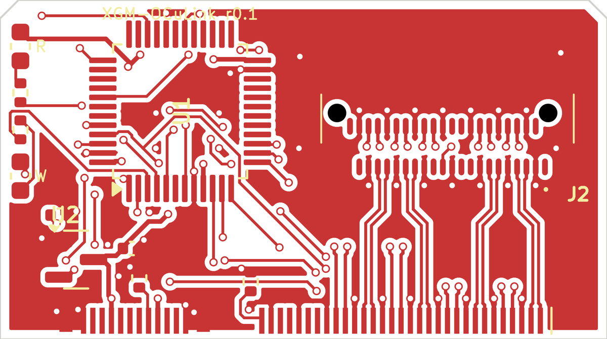
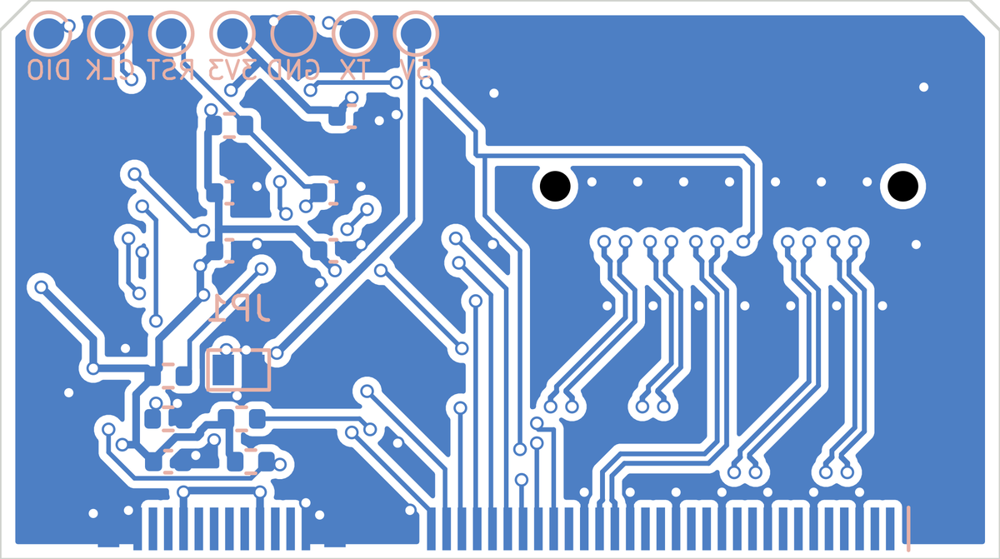

XGM to OCuLink Adapter
======================
A 33 x 18 mm board that plugs straight into the XG Mobile port of an ROG Flow / ROG Ally and presents a standard OCuLink 4i (SFF-8612) host port, so any off-the-shelf OCuLink eGPU dock can be used with a normal OCuLink cable.

**Status: untested design, revision 0.1. Do not order boards before working through [Before you order](#before-you-order).** The schematic is complete and checked; the board layout depends on the dimensions of a connector that had to be estimated from photos.

| Top copper | Bottom copper |
|---|---|
|  |  |

The XGM plug solders onto the lower edge, the OCuLink receptacle sits top right, the MCU top left.

## How it works
The XGM port is PCIe x8 plus a handful of sideband signals plus a USB-C port ([pinout](../Docs/Connector.md)). OCuLink 4i is PCIe x4 plus reference clock and reset. So the adapter has three jobs:

1. **Pass lanes 0-3 and the reference clock straight through.** No AC coupling capacitors are needed: PCIe puts them at each transmitter, so they already exist on the laptop motherboard and on the graphics card. Lanes 4-7 are left open and the host trains the link down to x4.
2. **Answer the handshake.** The laptop's embedded controller will not switch the PCIe mux over until a dock identifies itself over the sideband pins and the SMBus ([details](../Docs/MCU.md)). This is done by the same STM32F030C8T6, on the same pins, as the Lite dock, so the existing `XG_Mobile_Dock_MCU` firmware runs unmodified.
3. **Power itself.** OCuLink carries no power and there is no ATX supply here. A 5.1 kΩ resistor on CC1 makes the adapter look like a USB-C device, so the port's own USB-C half supplies 5 V on VBUS. A 3.3 V LDO feeds the MCU (about 10 mA).

`GPU_RST#` reaches the dock as OCuLink `PERST#` through the MCU, exactly as on the Lite dock. The other OCuLink sidebands (`CWAKE#`, `CPRSNT#`, the 2-wire bus, the 3.3 V / 5 V cable power pins) are not connected.

### About "you need redrivers"
A redriver is an amplifier that restores a PCIe signal which has been weakened by a long path. The comment that an adapter needs them assumed the adapter sits at the end of the ASUS XGM cable, so the signal would cross that cable *and* an OCuLink cable. This design removes the ASUS cable entirely: the plug is soldered to the board and the trace length from plug to OCuLink connector is about 10 mm. The signal path is laptop, 10 mm of board, one OCuLink cable, dock. That is comparable to the stock setup, so this revision is passive.

Expect PCIe 3.0 to work. PCIe 4.0 is plausible on a ROG Flow (which has redrivers on its motherboard) with a short, good cable, and less likely on a ROG Ally (which has none). If the link is unstable, use a shorter cable or let it fall back to 3.0, see the troubleshooting section of the [main README](../README.md).

## The connector problem
The male XGM plug is not a catalogue part. Parts stores only sell the receptacle that sits in the laptop. The only source is an ASUS XG Mobile cable ([part 14017-00810700](https://www.a-accessories.com/asus-connection-cable-62505-79153.htm), about $129, or a cable from a dead XG Mobile): open the cable head and desolder the plug from the small PCB inside. [These photos](../Docs/Diary.md#pin-mapping) show what that PCB looks like. The plug straddles the board edge, with rows A and C soldered on one face and rows B and D on the other.

Because of that, the plug footprint (`lib/XGM_OCuLink.pretty/XGM_Plug_Straddle.kicad_mod`) is an **estimate** made from those photos. The values that were guessed are at the top of `gen/make_fp.py`:

| Parameter  | Guess   | Meaning                                         |
|------------|---------|-------------------------------------------------|
| `pitch`    | 0.5 mm  | contact pitch, both sections                    |
| `pad_w`    | 0.28 mm | solder pad width                                |
| `pad_len`  | 1.4 mm  | solder pad length                               |
| `pad_edge` | 0.3 mm  | board edge to start of pad                      |
| `usb_gap`  | 4.1 mm  | centre of C31 to centre of A1                   |
| `shell_*`  |         | size and position of the shell tabs             |
| `board_t`  | 0.8 mm  | PCB thickness the plug is made to straddle      |

The outline of the board around the plug (notches for the plastic posts visible in the photos) is not modelled at all.

## Before you order
1. Get the plug. Measure it and the original cable-head PCB with calipers: every value in the table above, plus the cut-outs in the board edge.
2. Confirm with a multimeter that row D sits under row C with the same numbering (D1 under C1) and that B12 sits under A1. The original PCB has these labels on its silkscreen.
3. Put the measured values into `gen/make_fp.py` and regenerate (see below). The PCIe routing is computed from these numbers and follows them. Add the edge cut-outs in KiCad.
4. Check the chosen OCuLink receptacle against the footprint. It was drawn for the Amphenol G14A421211112HR; other SFF-8612 right-angle receptacles differ.
5. Enter the stack-up of your PCB fab into its impedance calculator and adjust `W_PAIR` / `GAP_PAIR` in `gen/make_pcb.py` for 85 Ω differential. The current 0.16 mm / 0.15 mm is an approximation for a 0.1 mm prepreg (JLC04081H-3313).
6. Run DRC in KiCad.

Things that can only be found out with a board in hand:

* Whether the port supplies VBUS early enough at boot for the MCU to answer the BIOS check. The `5V` pad (TP7) accepts external 5 V if it does not.
* Whether the plug stays seated. The original cable head latches into the laptop; this board is held by friction and the solder joints of the plug shell, with a stiff OCuLink cable hanging off it. A printed shell is advisable.
* Whether your dock powers the GPU up on its own. Docks that expect 3.3 V on the OCuLink cable power pins to switch on will need their manual power switch.

## Using it
Flash `XG_Mobile_Dock_MCU.bin` through the row of pads on the bottom side (`DIO`, `CLK`, `GND`, `3V3`), as described in the [main README](../README.md#stm32-mcu). `TX` is the debug log at 115200 baud.

The firmware's cable-lock input is left floating, which reads as "locked", so the adapter announces itself as soon as it is plugged in. Bridging `JP1` reads as "unlocked".

* White LED: connected and locked. Red LED: the host has enabled the eGPU.
* Windows: install [XGMDriver](../README.md#install-xgmdriver).
* Linux: the `asus-nb-wmi` driver exposes `egpu_enable` under `/sys/devices/platform/asus-nb-wmi/` (also reachable through `asusctl`). Write `1` to it after plugging in, then reboot or rescan the PCI bus.
* The USB-C half of the port is used up by the adapter. A ROG Flow can charge from its other USB-C port; a first-generation ROG Ally has no other port and cannot charge while the adapter is in.

## Files
| Path                                | Contents                                                  |
|-------------------------------------|-----------------------------------------------------------|
| `XGM_OCuLink_Adapter.kicad_sch`     | Schematic (generated: every pin carries a net label)      |
| `XGM_OCuLink_Adapter.kicad_pcb`     | 4-layer board, 0.8 mm, inner layers are solid ground      |
| `lib/`                              | Symbols and footprints used by the project                |
| `gen/design.py`                     | Parts, pins and nets. The single source of truth          |
| `gen/make_fp.py`                    | Plug footprint, with the estimated dimensions             |
| `gen/make_sch.py`                   | Writes the symbol library and the schematic               |
| `gen/make_pcb.py`, `gen/router.py`  | Placement, PCIe routing by construction, low-speed router |

To regenerate everything (KiCad 9 or later, with its Python module, numpy and scipy):

```
cd gen
./make_fp.py && ./make_sch.py
kicad-cli sch export netlist --format kicadsexpr -o /tmp/adapter.net ../XGM_OCuLink_Adapter.kicad_sch
./make_pcb.py /tmp/adapter.net      # takes about two minutes
```

The PCIe pairs are placed by formula, so their geometry is exact and repeatable. The low-speed nets are placed by a simple grid router: they are electrically correct and pass DRC, but they are not pretty, and are worth tidying by hand once the footprint is final.

## Layout notes
* TX pairs run on the top layer from plug row C to OCuLink row B. RX pairs drop to the bottom layer, pass under row B and come back up between the two pad rows to reach row A. Every ground pin next to a pair has its own via into the planes, at both connectors.
* Polarity and lane order are preserved end to end.
* The reference clock starts on the bottom face (row D) and has to cross lane 2 to reach the middle of the OCuLink connector. It does so on the bottom layer while RX2 is still on the top layer, so no pair crosses a gap in its ground plane.
* `PERST#` runs around the front of the OCuLink connector instead of across the pairs.

## Sources
* OCuLink pin assignment: SFF-9402 Rev 1.1, Table 7-1, root side.
* OCuLink footprint: Antmicro [oculink-pcie-adapter](https://github.com/antmicro/oculink-pcie-adapter) (Apache-2.0).
